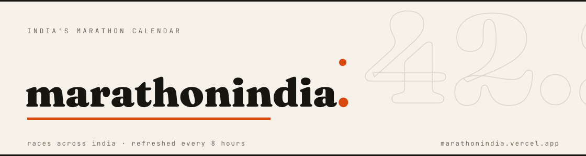

# Marathon India

India's running race calendar.

**[marathonindia.vercel.app](https://marathonindia.vercel.app)** · [Data](#data) · [Contributing](#contributing)

> **Status: live.** 268 races tracked across India, 247 of them upcoming, refreshed every 8 hours.
> Every race links back to its own source. Nothing here promises current availability - always check the organiser's page.

A static site: `index.html` + `styles.css` + `app.js` + `races.json`. No build step, no backend, no tracking.

- Pune-first default view with an All India toggle, state / city / distance filters, certified-only filter, and search.
- Every race card carries its certification evidence (AIMS member / WA Label / WA course cert with expiry / ITRA) and its own last-checked date. No blanket verified badge.
- Fees, GST treatment and entry requirements are never guessed: cards point to the registration page until an update cycle has captured them from the organiser.

## Data

`races.json` is the whole data layer. Sources include the punerunners.com race calendar, the AIMS / World Athletics India directory, indiarunning.com, geeksonfeet.com and official event sites.

Fields per race: `id, name, city, state, dateText, month, scope, distances[], url, certification, lastChecked, note, hasDiscount, source`.

## Update flow

A GitHub Action fetches sources every 8 hours and commits refreshed data. See UPDATING.md.

## Contributing

Spotted a wrong date, a dead link or a missing race? Open an issue or a pull request.
